# DSO202 — Assignment 4 Report
## GitOps with Argo CD: Delivering the Task Tracker to dev and staging (Unit IV 4.1–4.4)

---

## 1. Objective

In Assignments 1–3 the Task Tracker (frontend, backend, PostgreSQL) reached the cluster because I ran a command. This assignment removes that step. **Argo CD** runs inside the cluster, reads the desired state from a public Git repository ([`dso202-gitops`](https://github.com/DechenWangdraSherpa/dso202-gitops)) and makes the cluster match it. Each of the four OpenGitOps principles (declarative, versioned and immutable, pulled automatically, continuously reconciled) had to be proven with output from the running system, not just claimed.

Work was done in the brief's order on a new three-node `kind` cluster, `dso202-gitops`:

1. **Task 1:** assemble the repository (Assignment 3 chart, Assignment 2 quota/RBAC, Practical 1 kind config) with `.gitignore` as the first commit, make the chart meet contract C1–C11, and create the cluster.
2. **Task 2:** install Argo CD **v3.5.6** from pinned Kustomize files with server-side apply.
3. **Task 3:** create two AppProjects (`platform` admin, `dso202` least privilege) and the **root** app-of-apps Application.
4. **Task 4:** install Sealed Secrets **0.40.0** through Git, back up the sealing key, and deliver namespaces, quota, limits, RBAC and sealed credentials for both environments.
5. **Task 5:** add a PostSync smoke test and tag `v1.0.0`. Dev follows `main` with automated sync; staging is pinned to a tag with manual sync.
6. **Task 6:** add a read-only `reviewer` account, show its three `can-i` states, and grant log access by commit.
7. **Task 7:** promote a frontend release through the gate, survive a faulty backend release, recover with `git revert`, fix forward, and promote `v1.2.0`. Every change went through a pull request.
8. **Task 8:** run four drift drills (self-heal, reported drift, prune, project rejection), each with a prediction.
9. **Task 9:** destroy the cluster and rebuild it from the repository plus one backed-up key.
10. **Task 10 (bonus):** convert `tasktracker-dev` to a multi-source Application.

---

## 2. Environment

| Component | Value |
|---|---|
| Host OS | Kali GNU/Linux Rolling, kernel `7.2.15+kali-amd64`, zsh |
| Container runtime | Docker Engine `29.9.3` (native daemon) |
| Cluster | `kind v0.32.0`, cluster **`dso202-gitops`** from `cluster/kind-cluster.yaml` (Practical 1 topology: `control-plane`, `worker-node-1`, `worker-node-2`; host port `30080` mapped); context `kind-dso202-gitops` |
| Kubernetes | `v1.36.1` (`kindest/node:v1.36.1@sha256:3489c767…`) |
| kubectl / Kustomize | `v1.36.6` / `v5.8.1` |
| Helm | `v4.3.1` |
| Argo CD | server **v3.5.6**, `argocd` CLI **v3.5.6** |
| Sealed Secrets | Helm chart **2.20.0**, controller and `kubeseal` **0.40.0** |
| git | `2.53.0`; repository `https://github.com/DechenWangdraSherpa/dso202-gitops.git` (public, branch `main`, tags `v1.0.0`, `v1.1.0`, `v1.2.0`) |
| Images | `dwangshers/dso202-amd64-{frontend,backend,db}` baseline `1.0`, release `1.1` (frontend, backend); `busybox:1.37` for the smoke test |

**Deviations from the brief, and why:**

- **The `1.1` release images were built locally.** Only tag `1.0` of my images exists on Docker Hub, and no `1.1` tags had been issued. I built them from my Assignment 1 source to match the release notes. Frontend 1.1 shows "release 1.1" in the page header. Backend 1.1 has refactored configuration loading and refuses to start without `DB_SSLMODE`, which is the start-up requirement Task 7 has to discover from the logs. Both were loaded into kind with `kind load docker-image` (brief section 13), not pushed. The source diff and image IDs are in [`evidence/release-1.1-images.diff`](evidence/release-1.1-images.diff).
- **Old clusters were stopped, not deleted.** The brief says to delete the earlier `dso202` cluster because it holds port 30080. I stopped its containers (and `dso202-p5`) with `docker stop` instead, which frees the port without destroying earlier work. `kind get clusters` therefore still lists them.
- **ReplicaSet and Pod were added to the `dso202` whitelist** (commit `3a45b61`), with a comment. The brief says the whitelist should name exactly the kinds the chart renders. However, Argo CD leaves live resources of non-permitted kinds out of the application tree, so with the exact list no Pod was visible and Task 6's "reviewer can read Pod logs" was impossible, even for admin (§3, Task 6).
- **The database is a StatefulSet.** I took it from Assignment 2 rather than the Assignment 3 Deployment + PVC. Its PVC comes from `volumeClaimTemplates`, so the chart renders no PersistentVolumeClaim and the whitelist needs none.
- **`backendUrl` is also set per environment** (8082 dev, 8083 staging). The frontend's JavaScript calls the backend from the browser, so each environment's browser-facing API address differs; it lives in the values files like everything else that differs.
- **Screenshot 03 was taken after the Task 9 rebuild.** The host rebooted between Task 2 and Task 3, which wiped the unrendered captures of the Task 2 checks. Screenshot 03 re-runs the same read-only checks on the rebuilt cluster, so its Pod ages are from that cluster. The Task 2 apply itself appears again in screenshot 34.
- **The repository history was recreated once, before Task 3.** My first push went to `master` as a single commit. The brief requires `main` and `.gitignore` as its own first commit, so I deleted the repository and re-pushed it as separate commits. Argo CD had not read it yet, so nothing in the cluster depended on the old history.
- The brief's command `argocd version --client` was run with `--short`, and the Argo CD admin password was always passed by command substitution so that it never appears in a screenshot.

### Repository layout

```
Assignment4/
├── README.md                     ← this report
├── dso202-gitops/                ← the GitOps repository (pushed to GitHub)
│   ├── README.md                 ← purpose, versions, rebuild/cleanup commands, credentials, Q1–Q6
│   ├── .gitignore                ← first commit (Listing 1)
│   ├── cluster/kind-cluster.yaml
│   ├── bootstrap/argocd/         ← namespace, kustomization (v3.5.6), argocd-cm + argocd-rbac-cm patches
│   ├── bootstrap/root/           ← platform AppProject, root Application
│   ├── argocd/projects/dso202.yaml
│   ├── argocd/applications/      ← sealed-secrets, platform-dev/-staging, tasktracker-dev/-staging
│   ├── platform/{dev,staging}/   ← namespace, quota-and-limits, rbac, tasktracker-credentials.sealed.yaml
│   ├── charts/tasktracker/       ← chart (helpers, configmap, serviceaccount, database, backend, frontend, smoke-test-job)
│   ├── environments/{dev,staging}/values.yaml
│   └── docs/evidence.md          ← command output for every task (text)
├── dso202-keys/                  ← NOT in Git: sealing-key backup, generated credentials, reviewer password (mode 600)
├── evidence/                     ← watch logs, rendered templates, final state, git log, 1.1 image diff, raw captures
└── screenshots/                  ← 38 images used below
```

---

## 3. Procedure and Observations

### Task 1 — Repository, chart contract and cluster

```bash
docker version --format '{{.Server.Version}}'; kind version; kubectl version --client
helm version --short; git --version; argocd version --client --short; kubeseal --version
helm search repo sealed-secrets/sealed-secrets --versions | head -5
helm lint charts/tasktracker -f environments/dev/values.yaml
helm lint charts/tasktracker -f environments/staging/values.yaml
helm template tasktracker charts/tasktracker -f environments/dev/values.yaml | grep -E '^kind:' | sort | uniq -c
kind create cluster --config cluster/kind-cluster.yaml
kind get clusters; kubectl config current-context; kubectl get nodes
docker ps --filter name=dso202-gitops --format '{{.Names}}   {{.Ports}}'
```

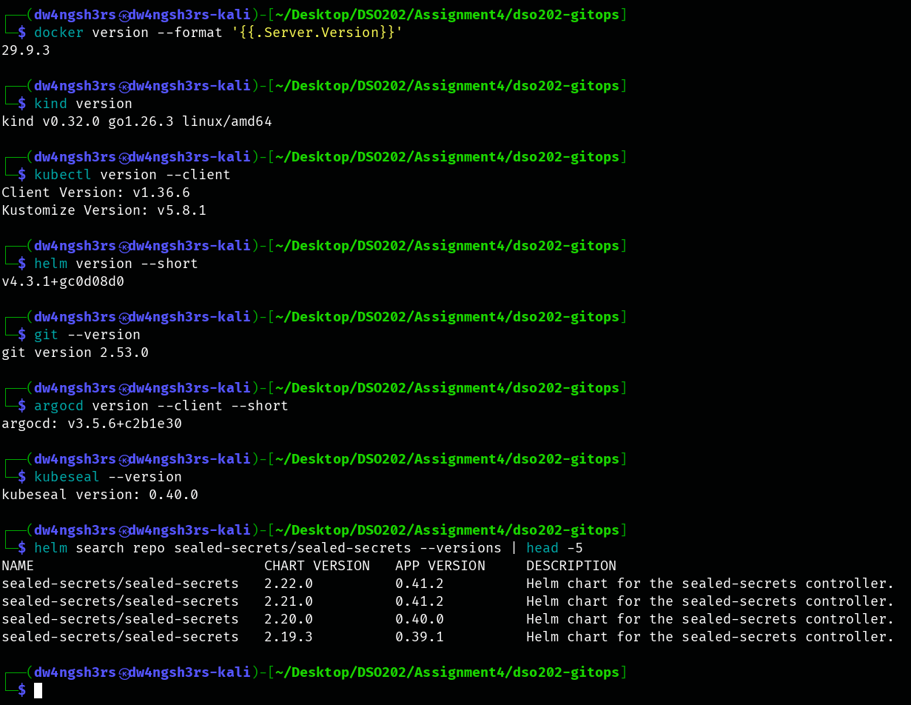

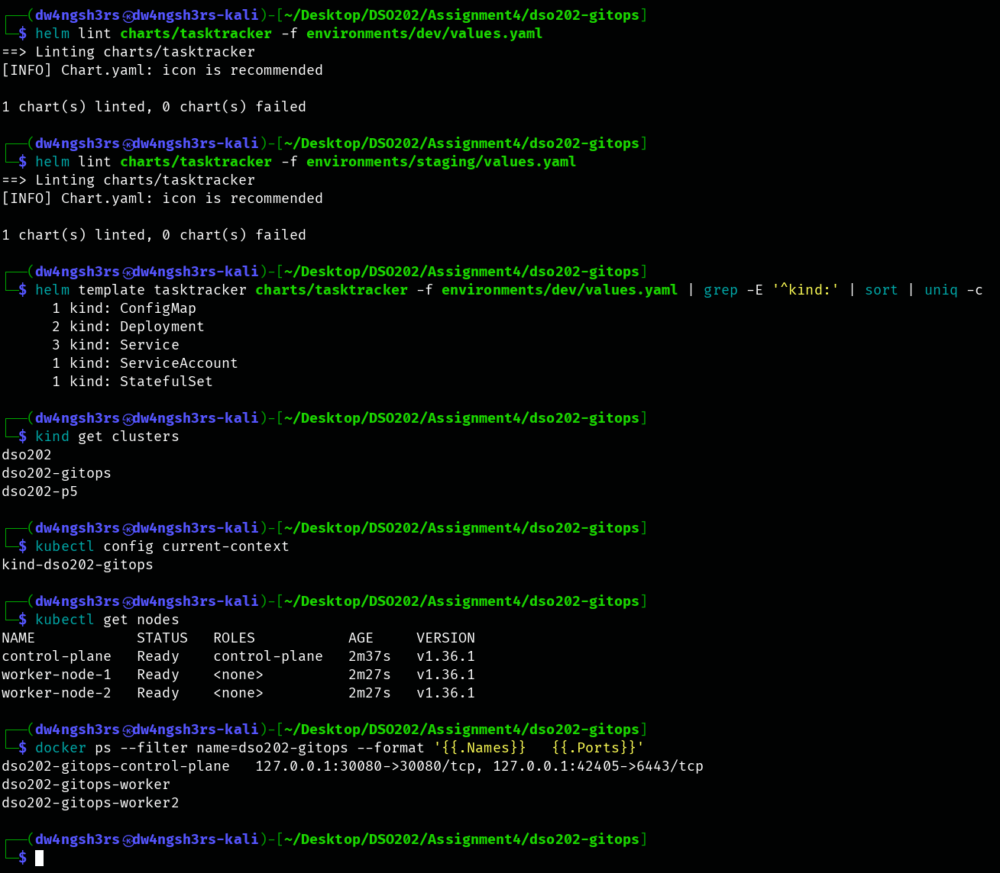

**Observation:** every pinned tool is present: `argocd v3.5.6`, `kubeseal 0.40.0`, and Helm can see chart **2.20.0 / app 0.40.0** in the Sealed Secrets repository. Newer charts (2.21.0, 2.22.0) exist but are deliberately not used. Both values files lint with `0 chart(s) failed`.

The chart renders only ConfigMap, Deployment ×2, Service ×3, ServiceAccount and StatefulSet: no Secret, Namespace, Quota or Role (C3, C8). The new cluster's three nodes are `Ready`, and only the `dso202-gitops-control-plane` container publishes `127.0.0.1:30080->30080`.

To meet the contract I changed the Assignment 3 chart in these ways:
- image repository and tag became per-tier values (C1);
- an `env` map per tier is rendered by a helper (C2);
- `app-secret` was removed in favour of `existingSecret` (C3);
- readiness probes were added on all tiers (C4);
- sync-wave annotations were set to 0/1/2 (C5);
- `progressDeadlineSeconds: 120` was added (C6);
- the frontend became a NodePort whose port is a value (C10).

The full table of where each requirement is satisfied is in [`dso202-gitops/docs/evidence.md`](dso202-gitops/docs/evidence.md#chart-contract).

### Task 2 — Argo CD from pinned, versioned files

```bash
kubectl kustomize bootstrap/argocd | grep -E '^kind: (Deployment|StatefulSet)' | sort | uniq -c
kubectl kustomize bootstrap/argocd | grep 'image:' | sort -u
kubectl apply -k bootstrap/argocd --server-side --force-conflicts
kubectl wait --for=condition=Available deployment --all -n argocd --timeout=300s
kubectl get pods -n argocd; kubectl get crd | grep argoproj.io
kubectl port-forward svc/argocd-server -n argocd 8080:443 &
argocd login localhost:8080 --username admin --password "$(argocd admin initial-password -n argocd | head -1)" --insecure
kubectl get configmap argocd-cm -n argocd -o yaml | grep -E 'timeout|accounts|health.argoproj'
argocd version
```

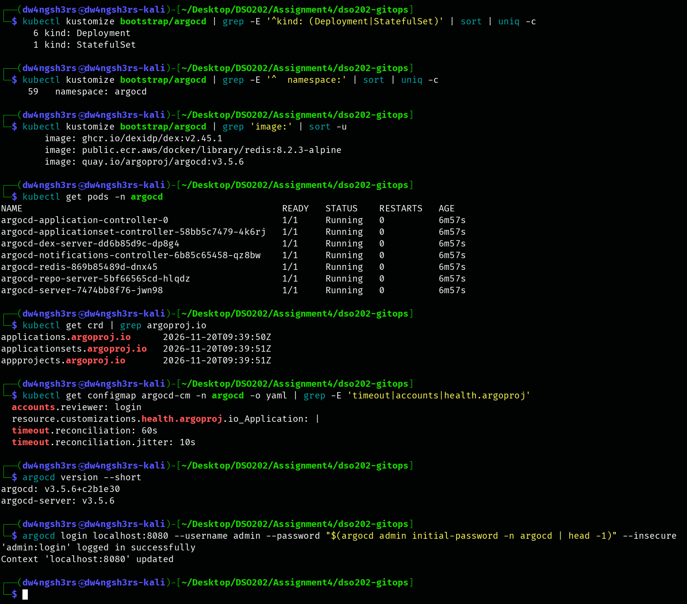

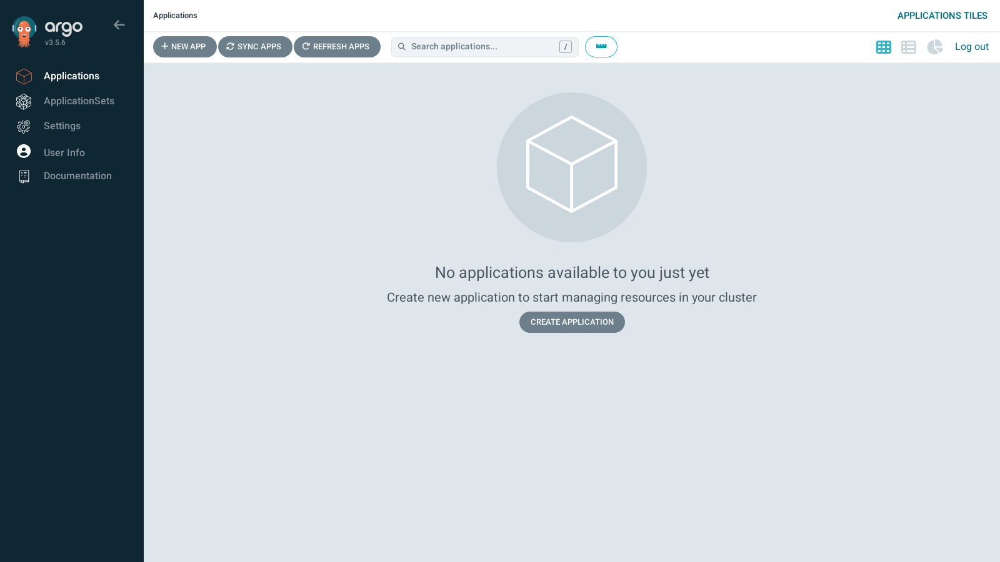

**Observation:** the Kustomize render contains exactly **6 Deployments and 1 StatefulSet**, and all 59 namespaced objects are in `argocd`. The images come from `ghcr.io`, `public.ecr.aws` and `quay.io/argoproj/argocd:v3.5.6`, none from Docker Hub. The upstream manifest is referenced by its `v3.5.6` tag URL, so the installation itself is a versioned file.

Seven Pods are `Running` and the three CRDs (`applications`, `applicationsets`, `appprojects`) exist. The `argocd-cm` excerpt shows the three local settings: the 60 s polling interval with 10 s jitter, the `reviewer` account, and the restored Lua health check for `Application` resources. Server and CLI both report v3.5.6. Server-side apply was required because the ApplicationSet CRD is larger than the 262144-byte limit of the client-side `last-applied-configuration` annotation.

### Task 3 — Boundaries and the root Application

```bash
kubectl apply -f bootstrap/root
kubectl get appproject,application -n argocd
argocd app get root
argocd proj get dso202
kubectl get appproject dso202 -n argocd -o jsonpath='{range .spec.namespaceResourceWhitelist[*]}{.group}/{.kind}{"\n"}{end}'
```

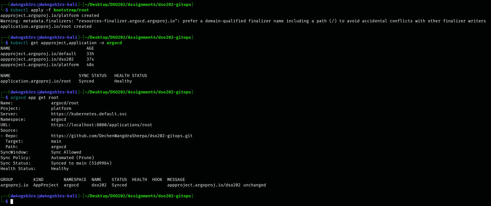

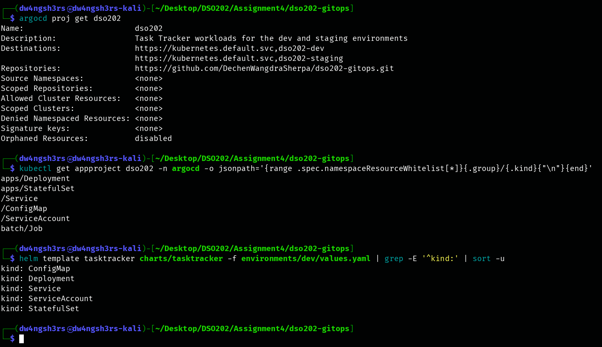

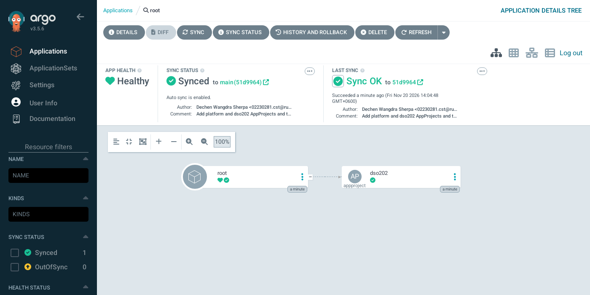

**Observation:** after applying only `bootstrap/root`, the three projects `default`, `platform` and `dso202` exist, and `root` is **Synced to main (51d9964)** and **Healthy**. `dso202` is 3 s younger than `platform` and appears as a row in `argocd app get root`, so the root created it from `argocd/projects/dso202.yaml` rather than me.

The project allows one repository, two destinations, **no cluster-scoped kinds**, and a namespaced whitelist identical to the chart's rendered kinds plus `Job` for the hook. The UI tree shows `root → dso202 (AppProject)`. From here on, adding a file under `argocd/` is the only way an Application is created.

### Task 4 — Sealed Secrets and the platform layer

```bash
# commit argocd/applications/sealed-secrets.yaml (wave -2), then:
kubectl get applications -n argocd; kubectl get pods -n sealed-secrets; kubectl get crd sealedsecrets.bitnami.com
kubectl get secret -n sealed-secrets -l sealedsecrets.bitnami.com/sealed-secrets-key -o yaml > ../dso202-keys/sealing-key.backup.yaml
chmod 600 ../dso202-keys/sealing-key.backup.yaml
export SEALED_SECRETS_CONTROLLER_NAMESPACE=sealed-secrets
kubectl create secret generic tasktracker-credentials --namespace dso202-dev \
  --from-env-file=secrets-plain/dev.env --dry-run=client -o yaml \
  | kubeseal --format yaml > platform/dev/tasktracker-credentials.sealed.yaml      # same for staging
rm secrets-plain/*.env
# commit the sealed files and platform-dev/-staging Applications (wave -1), then:
kubectl get namespaces | grep dso202; kubectl get sealedsecret -n dso202-dev
kubectl describe secret tasktracker-credentials -n dso202-dev
git log -p --all -S'<value>' | head      # for every value, plaintext and base64
```

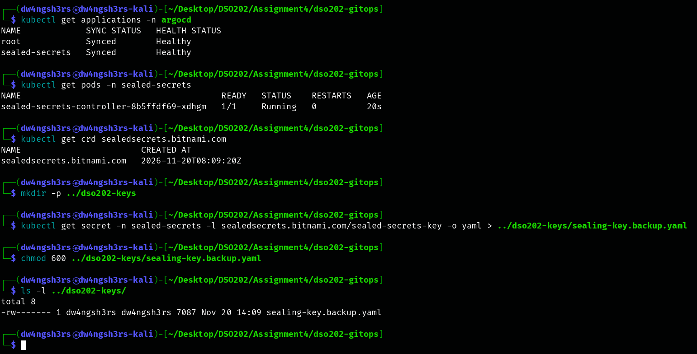

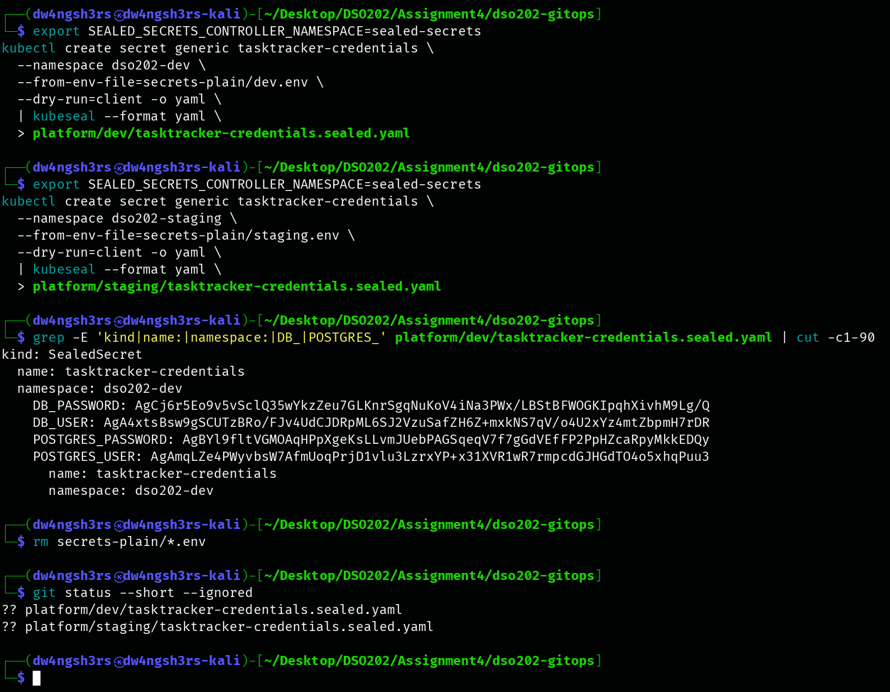

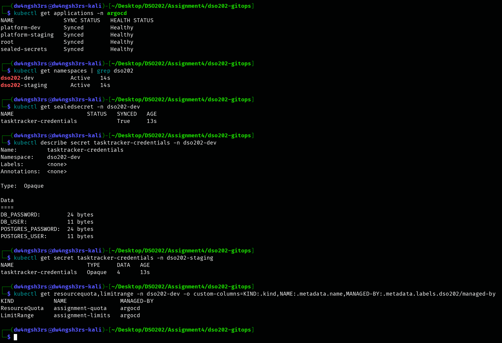

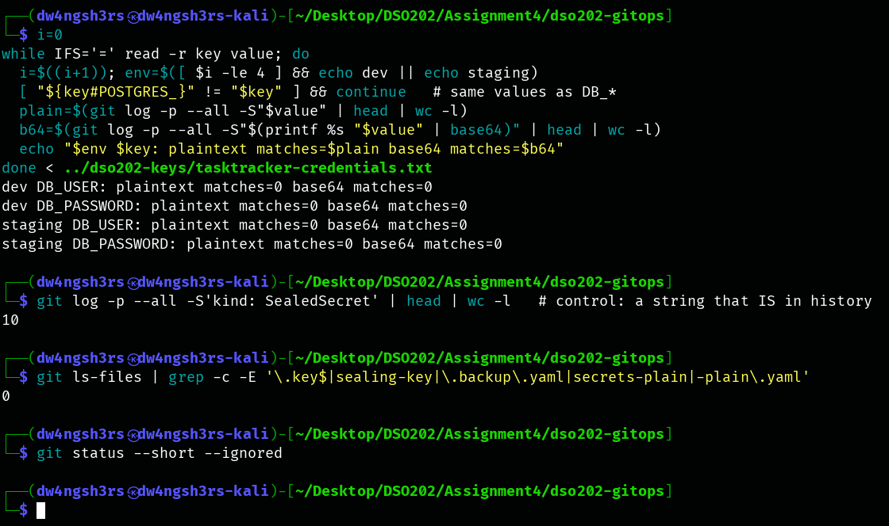

**Observation:** the Sealed Secrets controller arrived **through Git**. One commit of `sealed-secrets.yaml` made the root create the child Application, which installed chart 2.20.0 from the Bitnami Helm repository. The sealing key was backed up to `../dso202-keys/` (mode `-rw-------`) before anything was sealed; the file's contents are never shown.

The plaintext inputs were generated by a script, so no value ever reached the shell history. They were git-ignored and deleted after sealing. The committed files contain only `AgB…` ciphertext, bound to name `tasktracker-credentials` and namespace `dso202-dev`/`dso202-staging` (strict scope). Dev and staging have different passwords.

After the second commit, `platform-dev` and `platform-staging` became **Synced/Healthy** and created:
- both namespaces;
- the Assignment 2 quota and limits (`MANAGED-BY argocd`);
- the Secret in each namespace with four keys. `describe` shows sizes only.

Screenshot 11 searches every distinct value in **plaintext and base64** through all history: every result is 0. A control string that is in history returns 10 lines, which proves the search works. `git ls-files` contains no key or plaintext file.

### Task 5 — Workloads: waves, hook, health and the staging gate

```bash
# commit smoke-test-job.yaml; git tag -a v1.0.0; git push origin v1.0.0
# commit tasktracker-dev.yaml (main, automated) and tasktracker-staging.yaml (v1.0.0, manual)
kubectl get pods -n dso202-dev -w        # started before the push
kubectl logs job/tasktracker-smoke-test -n dso202-dev
argocd app get tasktracker-dev; argocd app get tasktracker-staging
argocd app sync tasktracker-staging
curl -s http://localhost:30080 ; kubectl port-forward -n dso202-staging svc/frontend-svc 8081:80 &
curl -X POST/GET/PUT/DELETE http://localhost:8082/api/tasks...
```

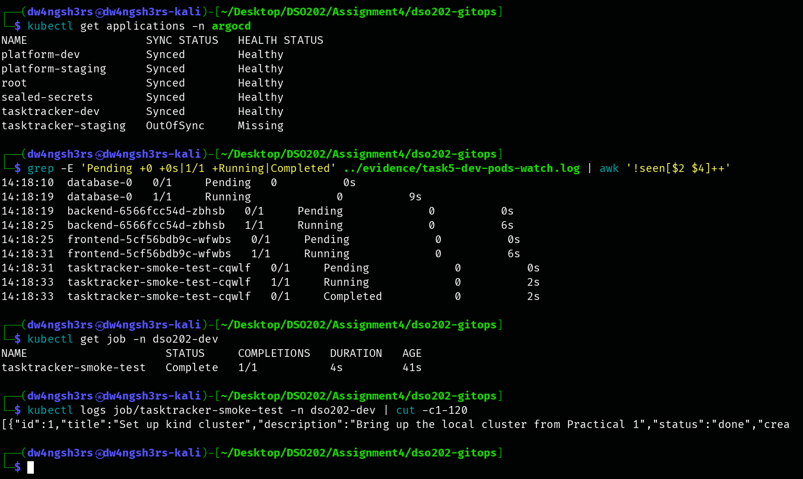

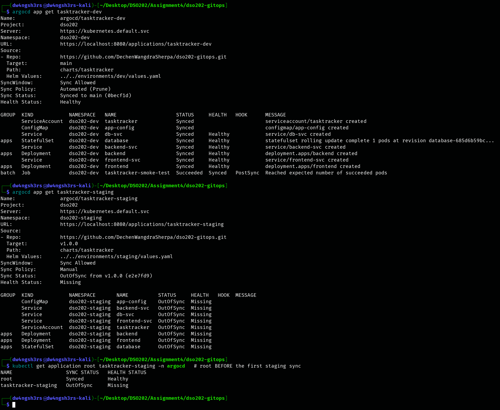

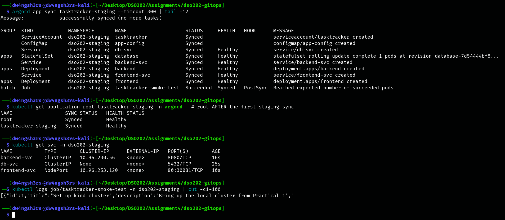

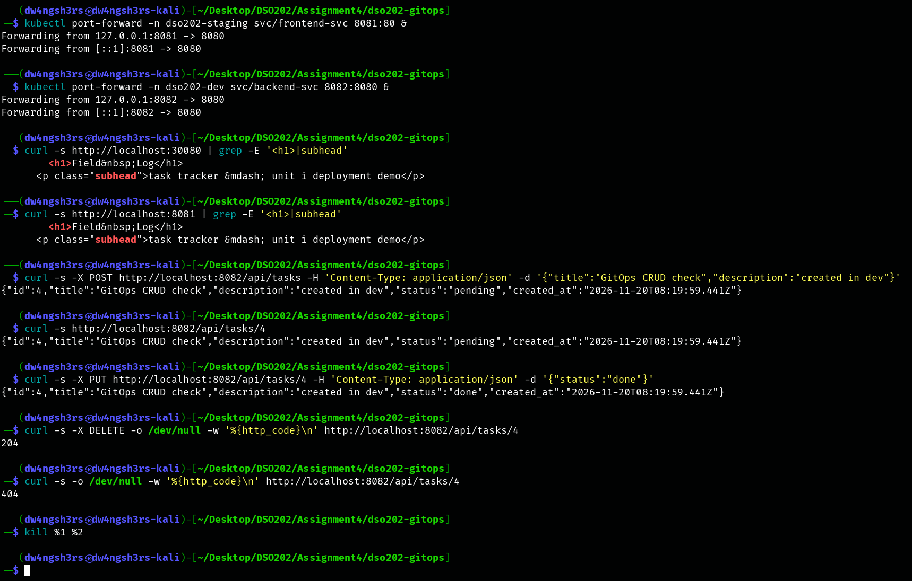

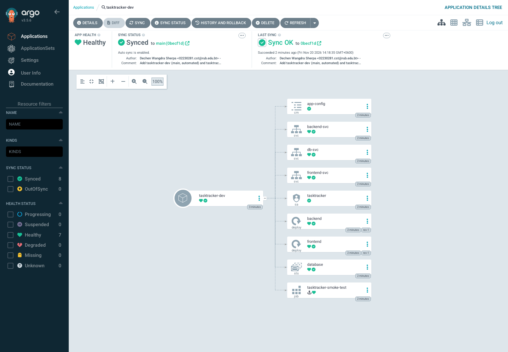

**Observation:** the watch shows the health-gated waves to the second:
- `database-0` was created at 14:18:10 and became ready at **14:18:19**; `backend` was created at **14:18:19**;
- the backend was ready at **14:18:25**, the moment `frontend` was created;
- the frontend was ready at **14:18:31**, when the PostSync smoke test started; it completed at 14:18:33.

The smoke-test log is the JSON task list from `GET /api/tasks`, which proves frontend → backend Service → database work together.

`tasktracker-dev` is **Synced to main / Healthy** with *Automated (Prune)*. `tasktracker-staging` is *Manual* and stayed **OutOfSync/Missing** at `v1.0.0` until I ran `argocd app sync`; after the sync its own smoke test also passed.

Dev answers on `localhost:30080`, and staging answers through the port-forward on 8081. In dev a task was created (`id 4`), read, updated to `done`, deleted (`204`) and then confirmed gone (`404`).

The brief expected `root` to stay **Progressing** while staging was never-synced. Here `root` reported **Healthy** before the first staging sync, with its child `Missing`. The health propagation itself works:
- during the dev waves the watch log shows `root` going **Progressing** and waiting (`evidence/task5-applications-watch.log`);
- in Task 7 `root` became **Degraded** with its child.

In v3.5.6 a child in `Missing`, however, did not lower the parent. I recorded this as observed rather than as expected.

### Task 6 — Argo CD access control

```bash
argocd account list
argocd account update-password --account reviewer --current-password ... --new-password "$(cat ../dso202-keys/argocd-reviewer-password.txt)"
argocd login localhost:8080 --username reviewer ... --insecure --name reviewer
argocd --argocd-context reviewer app list -o name
argocd --argocd-context reviewer account can-i get|sync applications 'dso202/*'
argocd --argocd-context reviewer account can-i get logs 'dso202/tasktracker-dev'
argocd --argocd-context reviewer proj get platform
# uncomment "p, reviewer, logs, get, dso202/*, allow", commit, then re-apply the bootstrap layer:
kubectl apply -k bootstrap/argocd --server-side --force-conflicts
argocd login localhost:8080 --username admin ...        # back to the admin context
```

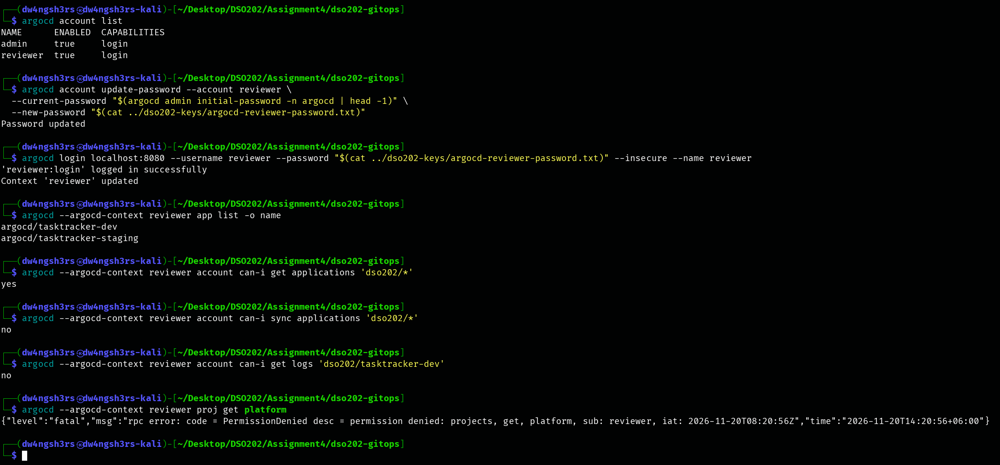

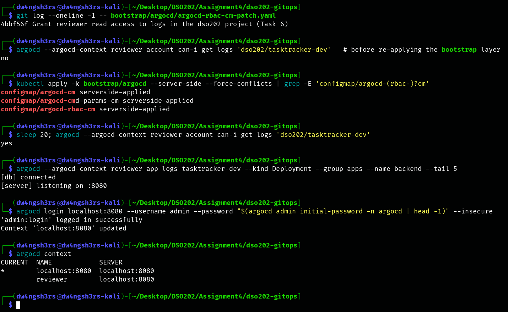

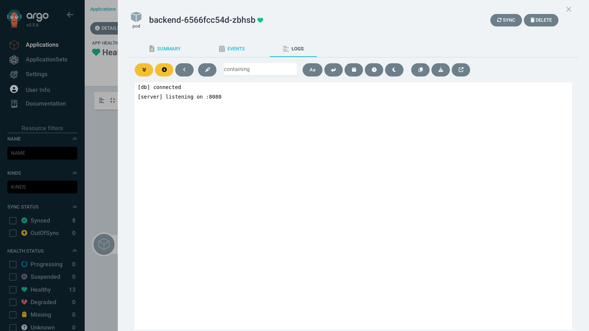

**Observation:** two accounts exist, `admin` and `reviewer`. With the policy from Listing 5, `reviewer`:
- lists only `tasktracker-dev` and `tasktracker-staging`;
- gets **yes** for `get applications`, **no** for `sync`, **no** for `get logs`;
- is **PermissionDenied** on project `platform`.

The logs rule was enabled in commit `4bbf56f`, but `can-i get logs` still said **no**. The ConfigMap belongs to the hand-applied bootstrap layer, which Git alone does not deliver. Re-applying `bootstrap/argocd` turned it to **yes**, and `argocd app logs` as reviewer printed the backend's `[db] connected` / `[server] listening on :8080`.

At first the UI and CLI returned no logs at all, even for admin. Argo CD omits live resources whose kind the project does not permit, and the exact whitelist did not include the ReplicaSets and Pods that Kubernetes creates for the chart. Adding `ReplicaSet` and `Pod` to `dso202` (commit `3a45b61`, with a comment) made Pods appear in the tree. Screenshot 19 is the reviewer's session on the backend Pod's **LOGS** tab.

### Task 7 — Release, failure and recovery through Git

Every change was a branch plus a squash-merged pull request:

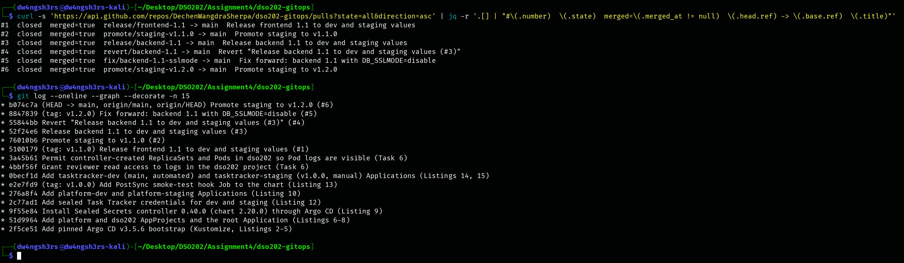

**Part A — frontend 1.1 and promotion**

```bash
# PR #1: frontend tag 1.1 in both values files (merged)
kubectl get pods -n dso202-dev -w; argocd app history tasktracker-dev
git tag -a v1.1.0 -m "Release: frontend 1.1"; git push origin v1.1.0
# PR #2: tasktracker-staging targetRevision v1.0.0 -> v1.1.0 (merged)
argocd app get tasktracker-staging; argocd app sync tasktracker-staging
```

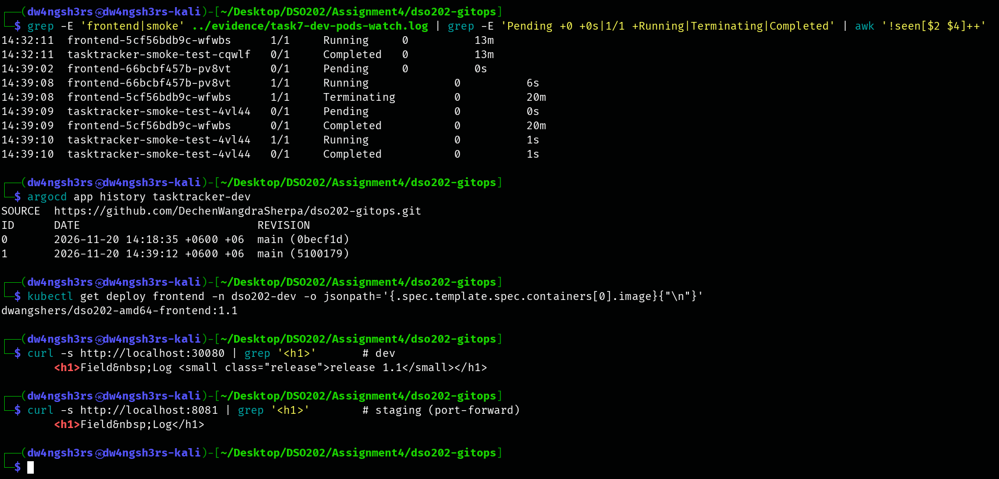

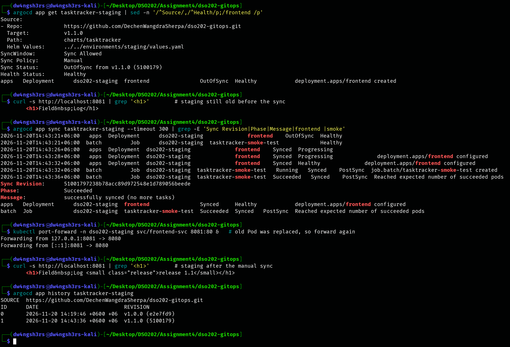

**Observation:** about a minute after PR #1 merged, dev replaced the frontend Pod (14:39:02 → ready 14:39:08) and re-ran the smoke test. History gained revision `main (5100179)`, and the dev header shows `release 1.1`. Staging still served the old header, because it reads `v1.0.0`.

After PR #2, the root applied the new `targetRevision`. Staging became **OutOfSync from v1.1.0** but kept serving the old page, since a manual sync policy detects but does not apply. Only my `argocd app sync` rolled it. The port-forward had to be restarted because it was bound to the replaced Pod.

**Part B — faulty backend, diagnosis, revert, fix forward**

```bash
# PR #3: backend tag 1.1 in both values files -> bad commit 52f24e6
kubectl get applications -n argocd; kubectl get pods -n dso202-dev; argocd app get tasktracker-dev
kubectl describe pod <new-backend-pod> -n dso202-dev; kubectl logs <new-backend-pod> -n dso202-dev
argocd app rollback tasktracker-dev
# PR #4: git revert 52f24e6 ; PR #5: backend 1.1 + backend.env.DB_SSLMODE=disable
git tag -a v1.2.0 ...; # PR #6: staging -> v1.2.0 ; argocd app sync tasktracker-staging
argocd app history tasktracker-staging
```

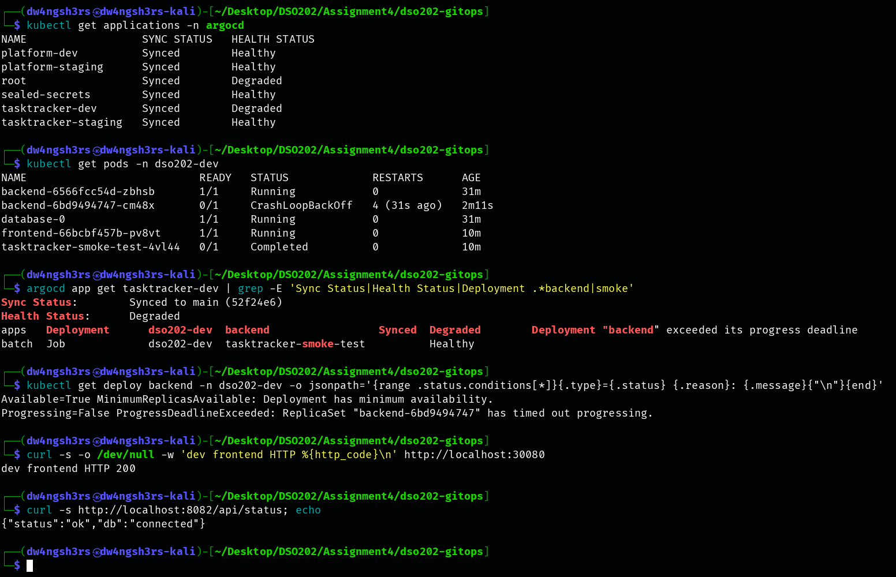

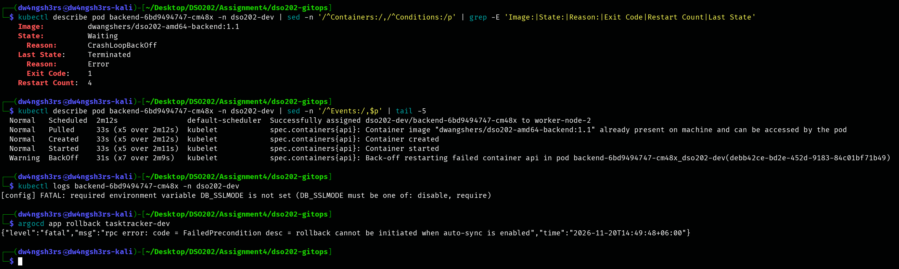

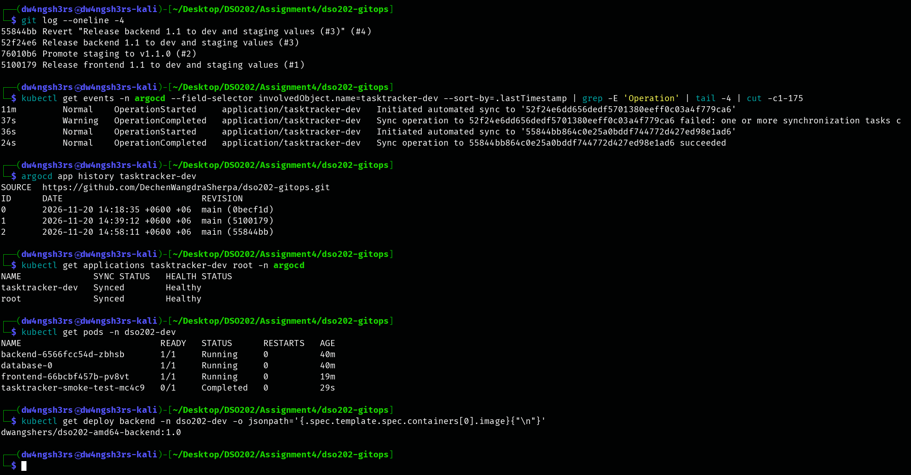

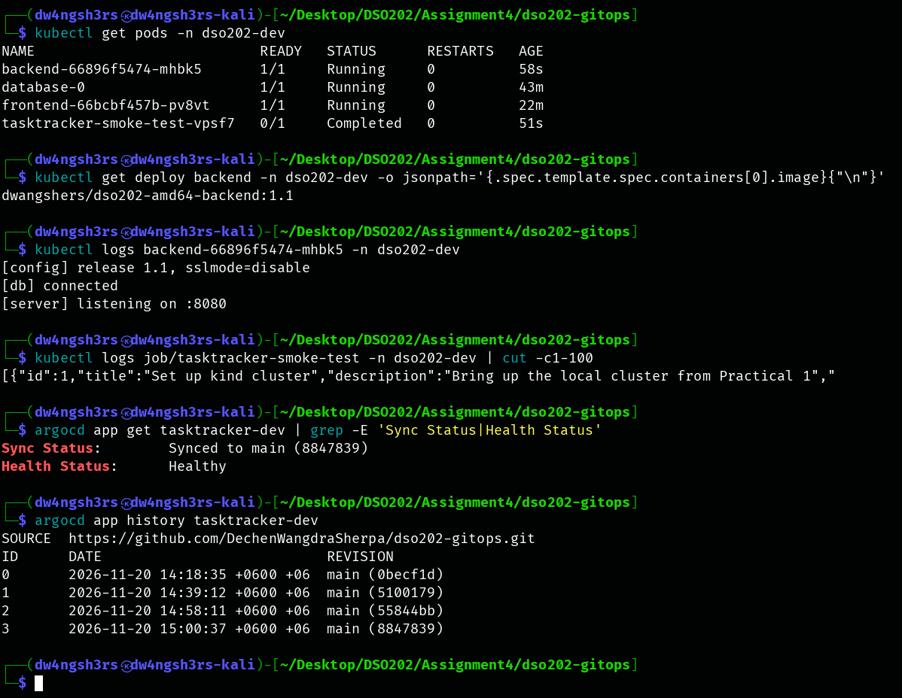

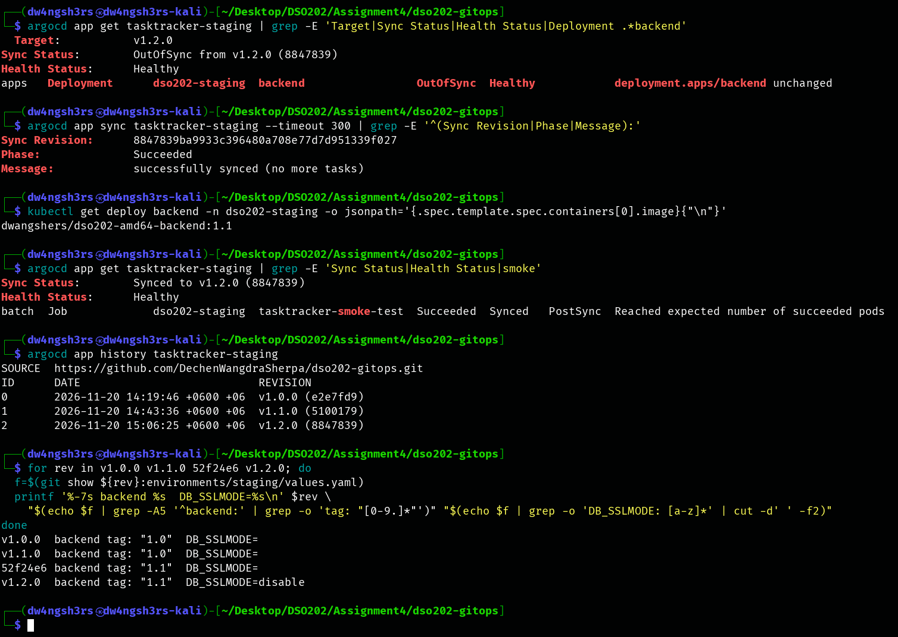

**Observation:** after the bad commit, the new backend Pod (image `1.1`) went into **CrashLoopBackOff** (exit code 1), while the old `1.0` Pod stayed `1/1 Running`. Because the rolling update never removes the last available Pod, the API still answered `{"status":"ok","db":"connected"}` and the frontend still returned 200.

The Application was **Synced to main (52f24e6) but Degraded**, with the message `Deployment "backend" exceeded its progress deadline`: 120 s, thanks to C6. `root` turned **Degraded** too. The smoke test did **not** run again, because a PostSync hook waits for a Healthy sync. Staging, reading `v1.1.0`, was untouched.

The new Pod's log gave the exact requirement:

```
[config] FATAL: required environment variable DB_SSLMODE is not set (DB_SSLMODE must be one of: disable, require)
```

`argocd app rollback` was refused: `FailedPrecondition desc = rollback cannot be initiated when auto-sync is enabled`.

The revert (PR #4, `55844bb`) brought dev back to **Healthy** on backend `1.0`, and the history keeps both the bad commit and its revert. Recovery was **not** instant: dev stayed Degraded for about three minutes after the revert merged. The events show why. The sync of the bad commit was still running its five retries, and it ended `failed … (retried 5 times)` at 14:57:59. The revert's automated sync started one second later. `app history` has no entry for `52f24e6`, because only successful syncs are recorded.

The fix forward (PR #5) only changed values: tag `1.1` plus `backend.env.DB_SSLMODE: disable`, rendered by the chart (C2). The new Pod logs `[config] release 1.1, sslmode=disable`, the Application is Healthy, and the smoke test passed. After tagging `v1.2.0` and PR #6, staging was synced by hand.

Staging's history is `v1.0.0 → v1.1.0 → v1.2.0`. The per-revision check shows that only `52f24e6` had backend 1.1 without `DB_SSLMODE`, and that commit was never a staging revision.

### Task 8 — Continuous reconciliation drills

| Drill | Prediction (written before running) | Result |
|---|---|---|
| 1. Scale dev backend to 3 by hand | Reverted to 1 within seconds (`selfHeal: true`) | **Held:** 3 → 1 in the same second, via a self-heal "partial sync" |
| 2. Scale staging backend to 3 | Stays at 3; reported `OutOfSync` with a `replicas` diff; only a manual sync restores it | **Held:** 3/3 after 75 s, diff `replicas: 3` vs `1`, restored by `argocd app sync` |
| 3. Add then `git rm` a ConfigMap | Appears after the add commit, deleted after the removal (`prune: true`) | **Held:** created in 4 s, `NotFound` after `3aee28f` |
| 4. Commit a ResourceQuota inside the chart | Sync refused, "not permitted in project dso202"; staging unaffected (reads a tag) | **Held:** exact message below; dev unchanged; staging Synced on `v1.2.0` |

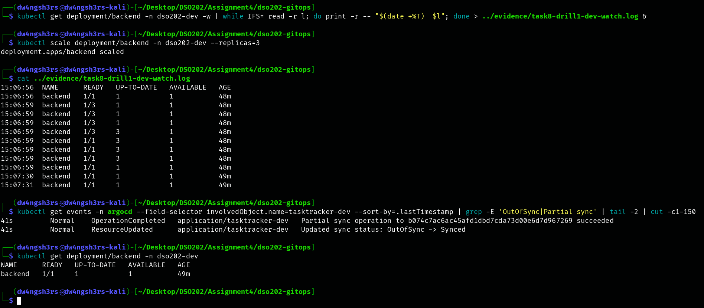

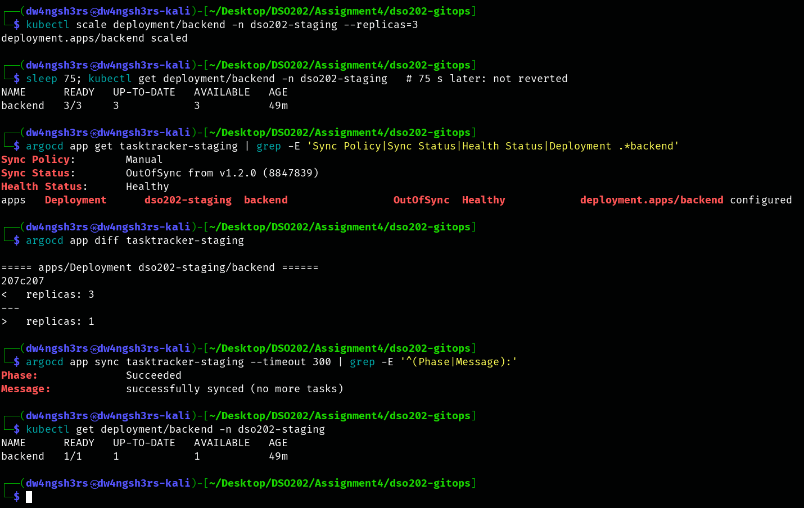

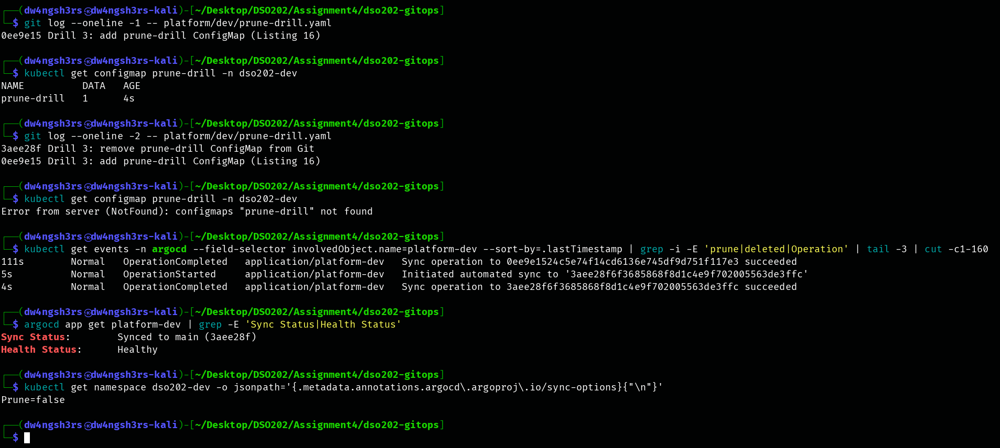

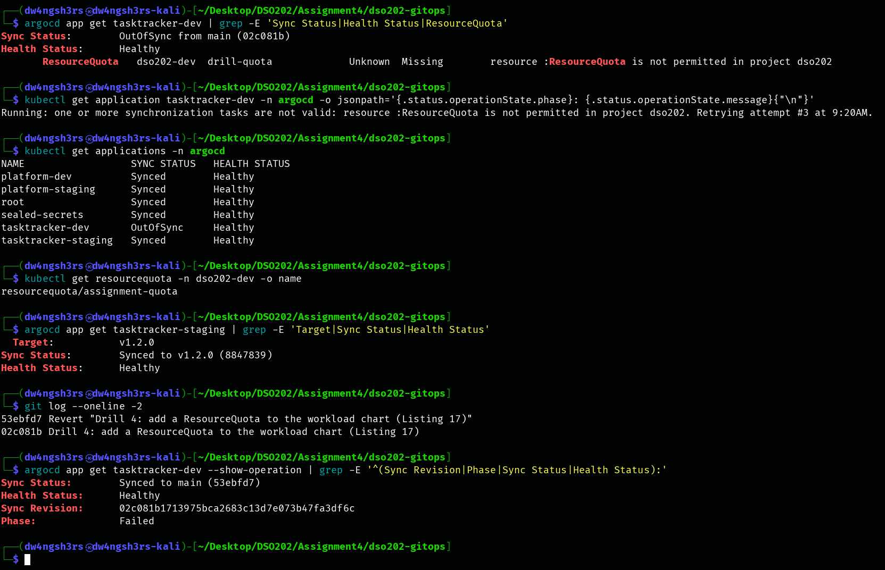

**Observation:**
- **Drill 1:** the watch was started first, and recorded `UP-TO-DATE 1 → 3 → 1` all at 15:06:59. Self-heal reacted within one second (principle 4, `selfHeal: true`).
- **Drill 2:** staging kept 3 replicas until I synced. Argo CD continuously **detected** the drift (OutOfSync plus a precise diff) but did not correct it, because staging has no `automated` block. That is the purpose of the staging gate.
- **Drill 3:** the ConfigMap disappeared after `git rm` (prune). The namespace carries `Prune=false`, so deleting `platform/dev/namespace.yaml` would not delete `dso202-dev` and everything inside it. That protection is explained here but, as the brief says, not tested.
- **Drill 4:** the exact message was `one or more synchronization tasks are not valid: resource :ResourceQuota is not permitted in project dso202`. The sync was retried and refused; nothing was created, and dev stayed Healthy at OutOfSync. Staging was unaffected because it follows the tag `v1.2.0`, which does not contain the drill commit.

  After the revert (`53ebfd7`), dev is `Synced`. The last *operation* still reads `Failed` because it is the exhausted sync of `02c081b`. The revert's manifests equalled the live state, so no new operation was needed.

### Task 9 — Rebuild from the repository and one key

```bash
kubectl get secret -n sealed-secrets -l sealedsecrets.bitnami.com/sealed-secrets-key -o yaml > ../dso202-keys/sealing-key.backup.yaml
git rev-parse HEAD; kubectl get applications -n argocd
date; kind delete cluster --name dso202-gitops
kind create cluster --name dso202-gitops --config cluster/kind-cluster.yaml
kind load docker-image <images> --name dso202-gitops            # section 13 (1.1 images are local)
kubectl create namespace sealed-secrets
kubectl apply -f ../dso202-keys/sealing-key.backup.yaml          # BEFORE the controller exists
kubectl apply -k bootstrap/argocd --server-side --force-conflicts
kubectl apply -f bootstrap/root                                  # nothing else by hand
kubectl get applications -n argocd -w
argocd login ...; argocd app sync tasktracker-staging
```

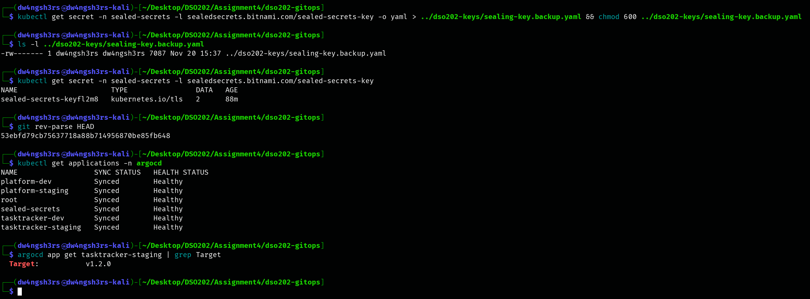

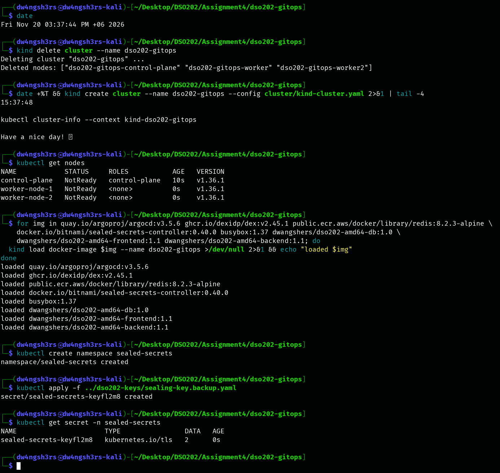

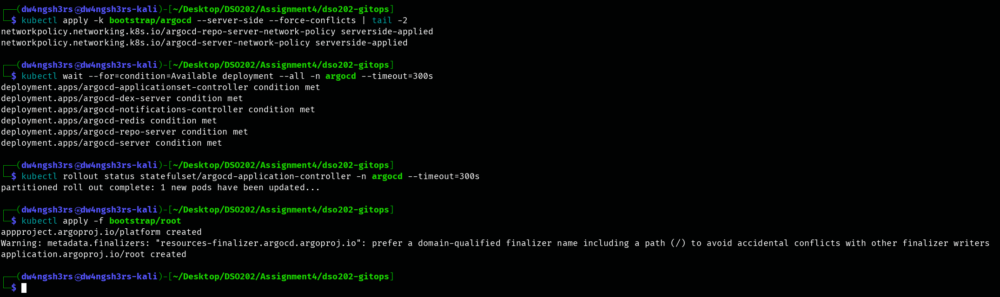

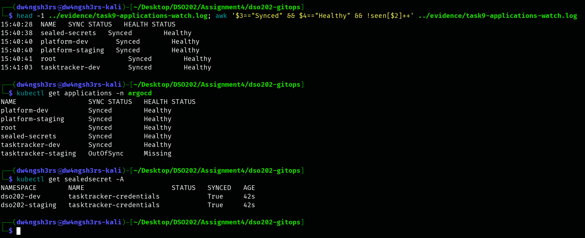

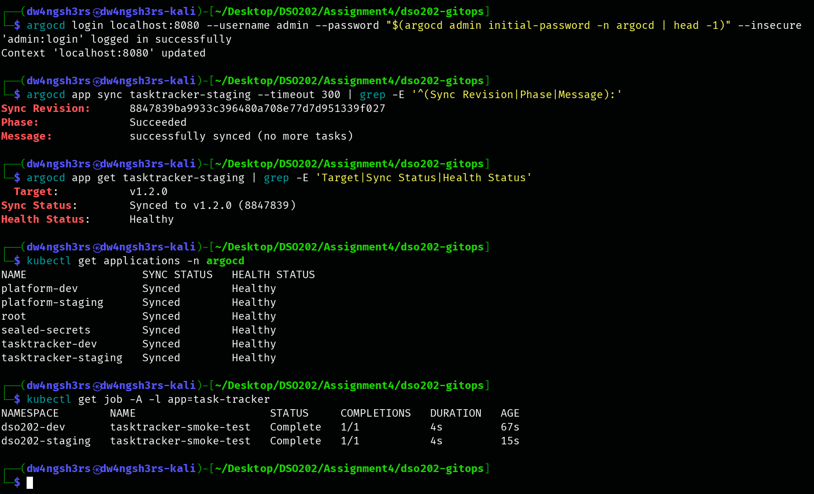

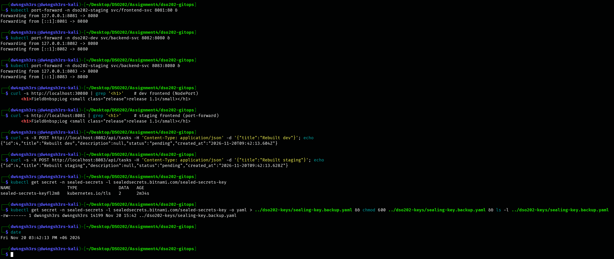

**Observation:** the restored key (`sealed-secrets-keyfl2m8`) was put back before the controller existed. The Applications then became Synced+Healthy in wave order: `sealed-secrets` (15:40:38), then `platform-dev` and `platform-staging` (15:40:40), then `root`, then `tasktracker-dev` (15:41:03).

The platform Applications could only become Healthy if the **old** key decrypted the SealedSecrets committed in Task 4, which `SYNCED True` for both confirms. No new key was generated: the namespace still holds exactly one.

After signing in with the new admin password and syncing staging, both smoke tests were `Complete`. Both headers show release 1.1, and each fresh database accepted a new task (`id 4`, after the three seed rows).

| | Time |
|---|---|
| `date` at start | 15:37:44 |
| `kind create cluster` started | 15:37:48 |
| dev frontend answered HTTP 200 | **15:41:12** → **3 min 24 s** |
| `date` at end (after verification and backup) | 15:42:13 |

Staging is on the same tag as before the rebuild (`v1.2.0`), and the repository HEAD (`53ebfd7…`) was the only input besides the key. The database contents from before the rebuild were lost, as the brief states. The fresh backup is larger (14199 vs 7087 bytes) only because `kubectl apply` added a `last-applied-configuration` annotation to the restored key.

### Task 10 (bonus) — Multi-source Application

```yaml
sources:
  - repoURL: https://github.com/DechenWangdraSherpa/dso202-gitops.git
    targetRevision: main
    path: charts/tasktracker
    helm:
      releaseName: tasktracker
      valueFiles: [ $values/environments/dev/values.yaml ]
  - repoURL: https://github.com/DechenWangdraSherpa/dso202-gitops.git
    targetRevision: main
    ref: values
```

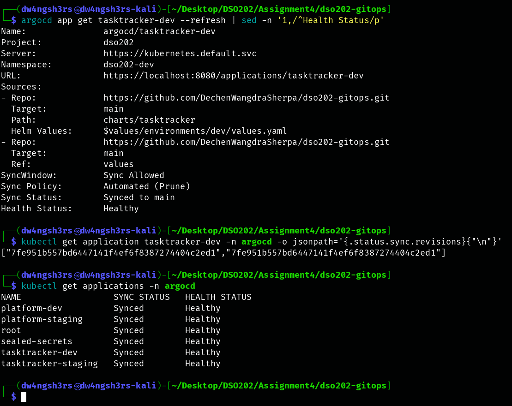

**Observation:** after one commit, `argocd app get` lists **Sources:** with two entries. The chart uses `Helm Values: $values/environments/dev/values.yaml`, and a second source has only `Ref: values`. `status.sync.revisions` holds one revision per source, and the Application stayed **Synced/Healthy**: the render is identical, only the wiring changed.

Separating the sources is useful when chart and configuration have different owners or speeds. For example, a platform team could pin the chart to a reviewed tag while the application team's values follow a branch of a separate configuration repository. A values change could then never pull in an untested chart change, and a chart upgrade would be a deliberate one-line promotion.

---

## 4. Analysis — Written Answers Q1–Q6

(The same answers, with more detail, are in [`dso202-gitops/README.md`](dso202-gitops/README.md#written-answers).)

**Q1 — Why is `platform` applied by hand while `dso202` is created by the root? What if `dso202` could deploy into `argocd`?**
The root Application must belong to a project, so that project has to exist before the root and before anything is read from Git. `platform` is therefore part of the bootstrap. It is also the administrator project (writes to `argocd`, creates cluster-scoped kinds), and keeping it out of the Git-delivered tree means an ordinary commit cannot widen it. `dso202` is an ordinary declarative object, so the root delivers it at wave −3, versioned and reviewed like everything else.

If `dso202` could deploy into `argocd`, a commit to the Task Tracker chart could create an `Application` (or `AppProject`) in that namespace. That Application could name any project, such as `platform`, and deploy anything anywhere, so the workload project would have granted itself administrator rights. Only `platform` may target `argocd`.

**Q2 — What does strict scope prevent? What is lost, and what must be done, if the key is lost?**
Strict scope encrypts the Secret's name and namespace with the data. A SealedSecret copied into another namespace or renamed cannot be decrypted, so the staging ciphertext cannot be replayed in dev, and a manifest cannot be silently retargeted. That is why each environment was sealed separately.

If the key is lost, every SealedSecret in Git becomes permanently unreadable, and the values cannot be recovered from Git. Secrets already decrypted in a running cluster keep working only until that cluster is rebuilt; a rebuild then shows `no key could decrypt secret` and the platform Applications become Degraded. Recovery takes four steps:
1. let the controller create a new key;
2. re-seal every credential from the source of truth (password manager), or from new passwords, rotating the database password to match;
3. commit the new SealedSecrets;
4. back up the new key immediately.

**Q3 — `Synced` vs `Healthy`, with an example.**
Sync status compares Git with the cluster; health says whether the objects work. In Task 7, after the bad backend release, `argocd app get tasktracker-dev` showed **`Sync Status: Synced to main (52f24e6)`** and **`Health Status: Degraded`** (screenshot 22). The live Deployment matched Git exactly (image `1.1`), but its Pod crashed, and after 120 s the rollout was reported as failed.

The opposite case is Drill 2: staging was `OutOfSync` (3 replicas) but `Healthy`. A Synced-but-unhealthy state can be provoked deliberately by committing an image whose container exits on start, or an image tag that does not exist (`ImagePullBackOff`).

**Q4 — What does Argo CD RBAC control vs Kubernetes RBAC, and where is each configured? What would SSO change?**
Argo CD RBAC controls what a *person* may ask Argo CD to do through its UI, CLI or API: view, sync, delete, read logs, exec, per project and Application. It is configured in `argocd-rbac-cm` (`policy.csv`, `policy.default`; here `bootstrap/argocd/argocd-rbac-cm-patch.yaml`), with local accounts in `argocd-cm`.

Kubernetes RBAC (Assignment 2) controls what an identity talking to the *Kubernetes API* may do. It is configured with `Role`/`RoleBinding` objects, here `platform/<env>/rbac.yaml`. Argo CD's own controller acts through its ServiceAccount; Argo CD RBAC decides who may make it act. That is why `reviewer` cannot sync even though the controller can.

With SSO, the local `reviewer` account would disappear. `policy.csv` would bind identity-provider **groups** to roles, e.g. `g, my-org:dso202-reviewers, role:dso202-viewer` with `p, role:dso202-viewer, applications, get, dso202/*, allow` and the logs rule, plus `scopes: '[groups]'`. Access would then be managed in the identity provider, not in Argo CD.

**Q5 — Why is `argocd app rollback` refused, what is the GitOps equivalent, and why `git revert`?**
With automated sync, a rollback would make the cluster differ from Git, and the next reconciliation would re-apply Git. The rollback would undo itself while Git still claimed the bad release was desired. Argo CD therefore refuses it: `rollback cannot be initiated when auto-sync is enabled`.

The GitOps equivalent is to change the desired state: `git revert <bad-sha>` merged through a PR (PR #4). The cluster then pulls the reverting commit like any release.

`git revert` adds history instead of rewriting it. Deleting the bad commit means force-pushing a shared branch, which breaks clones and open branches, can invalidate tags and Argo CD's recorded revisions, and destroys the audit trail. Here the history `52f24e6 → 55844bb → 8847839` shows exactly what was released, undone and fixed.

**Q6 (a) — Single repository for chart and configuration: two advantages, two disadvantages.**

Advantages:
1. A chart change and the values it needs land in **one commit and one tag**, so `v1.2.0` is a complete, reproducible release and staging pins one reference.
2. It is **simple to operate and audit**: one URL in every project and Application, one review flow, one history to search for secrets, and Task 9 rebuilt everything from one clone.

Disadvantages:
1. **Coupled permissions and history.** Whoever may change values may also change the chart and the Argo CD objects, and all of it shares one noisy commit stream.
2. **Coupled triggers.** Every commit to `main` (even documentation) refreshes every Application on `main`, and the chart cannot be pinned while values float, except with the multi-source pattern of Task 10.

**Q6 (b) — What is not under GitOps control after the rebuild, and how production teams handle it.**
- **Bootstrap layer** (Argo CD install and its two ConfigMaps): applied by hand. Task 6 showed a committed RBAC change doing nothing until it was re-applied. Teams let Argo CD manage its own installation through an Application, or install it with Terraform or a cluster-provisioning pipeline.
- **Root Application and `platform` project:** created by hand once per cluster. Teams create them with the same provisioning tooling (Terraform, Cluster API, Argo CD Autopilot) or from a management cluster.
- **Sealing key:** outside Git by design. Teams keep it in a vault or secrets manager with backups and audit, or use External Secrets Operator so no cluster-specific key needs restoring.
- **Database contents:** state, not configuration, and lost in Task 9. Teams use scheduled backups with point-in-time recovery (Velero, pgBackRest, a managed database) and rehearse restores.
- **Locally loaded images and per-cluster passwords** (`reviewer`, the generated admin password). Teams push images to a registry they control and use SSO, so there are no per-cluster passwords.

---

## 5. Reflection

The mistake that taught me the most was in Task 6. I had followed the brief exactly: the `dso202` whitelist named only the six kinds my chart renders, the reviewer's logs rule was committed and re-applied, and `can-i get logs` said **yes**. Yet the reviewer's UI showed no Pods, and even `argocd app logs` as admin printed nothing. `argocd app get -o tree` exposed the cause: every Deployment was listed with **no** ReplicaSet or Pod under it. Argo CD drops live resources of kinds the project does not permit, and the Pods are created by Kubernetes, not rendered by my chart. My least-privilege list was "correct" by the brief's rule and still made the feature unusable. I added `ReplicaSet` and `Pod`, with a comment saying why. That was a reminder that a security boundary has to be checked against what the system actually needs at run time, not only against what I deploy.

Task 7 showed me that output has to be read, not assumed. After merging the revert, dev stayed **Degraded** for three minutes. I expected recovery within a minute and almost blamed polling. The Argo CD events showed the real reason: the sync of the bad commit was still retrying. It finished `failed … (retried 5 times)` at 14:57:59, and the revert's sync started the next second. In a real incident, a long retry policy on an automated Application delays the fix by the same amount, and an operator who doesn't know this might start "fixing" things by hand, which self-heal would revert.

Two smaller slips were caught by output too. My first check of which backend tag each staging revision deployed printed an error, because in zsh `$t:e` is a filename modifier, not "`$t` followed by `:e`". The second was `git tag --contains 52f24e6`: it listed `v1.2.0`, which looked alarming until I realised it only means the bad commit is an *ancestor* of the tag, not that staging ran it. Reading the values file at each revision answered the real question.

The environment fought back as well. The host rebooted between Task 2 and Task 3. Docker stopped, the scratchpad and unrendered captures were wiped, and the Argo CD Pods needed a restart. The cluster itself, and everything in Git, survived untouched. That was a small, unplanned version of Task 9's point: what is in Git and in the backed-up key comes back, and everything else has to be rebuilt.

My first push also went to `master` as one commit. I recreated the repository on `main` with `.gitignore` as its own first commit before Argo CD ever read it. With GitOps, the repository's history *is* the evidence, so it has to be right from the start.
